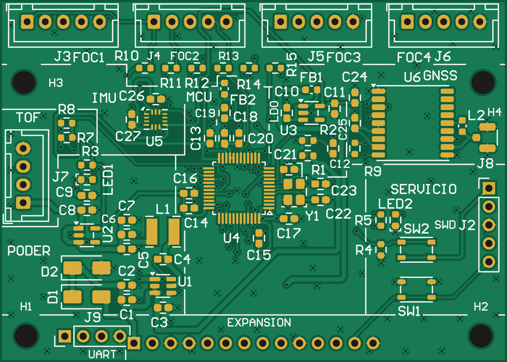

# ELO301 — Módulo de control secundario (Grupo 1)

Esquemático y PCB en Altium Designer 26 del módulo de control secundario del resBot: la placa de expansión que va sobre la
motherboard junto a la Radxa Zero 3W. Implementa el [Documento de Diseño v5](docs/Documento_de_Diseno_ELO301_Grupo1_v5.pdf)
con los cambios de la [auditoría del 01/11/2026](#auditoría-01112026).

## Estado (02/11/2026)

| Ítem | Estado |
|---|---|
| Esquemático | 4 hojas, 70 componentes (H3/H4 nuevos) |
| ERC | **0 errores**, 3 advertencias esperadas* |
| Componentes | Cada uno con huella, valor, fabricante, número de parte y código DigiKey (LCSC como segundo proveedor), también en la placa. Ver [metadatos DigiKey](#metadatos-digikey-02112026) |
| PCB (`ELO301_G1.PcbDoc`) | 4 capas, 70 x 50 mm, 70 componentes, ruteo completo, GND en las capas 2 y 3 y pours en Top y Bottom. **DRC: 0 violaciones**. Ver [cambios de placa](#cambios-de-placa-02112026) |
| Salidas de fabricación | **Desactualizadas**: corresponden a la placa del 01/11. Hay que regenerarlas ([detalle](#salidas-de-fabricación-fabricacion)) |

\* GNSS_PPS y UART_GNSS_RX llevan salidas del GNSS a pines E/S del MCU, y el nRESET del GNSS solo tiene su pull-up.

| Hoja | Contenido |
|---|---|
| [01 Alimentación](esquematicos/01_Alimentacion.png) | 12 V con B240A en serie y TVS SMAJ15A, buck AP63205 a 5 V, LDO TLV75533 para MCU y para sensores (con ferrita), LED de encendido, divisor 100k/12k + 100 nF hacia PA1 |
| [02 MCU](esquematicos/02_MCU.png) | STM32G431CBT6 con los 29 pines de la Tabla 9, desacoplos, VDDA con ferrita, cristal de 25 MHz (CL 10 pF, 2 × 12 pF), NRST y BOOT0 con pulsadores, LED heartbeat en PB6 |
| [03 Sensores](esquematicos/03_Sensores.png) | IMU BMI270 por SPI1, GNSS ATGM336H por USART2 + PPS con antena activa por U.FL (alimentada desde VCC_RF por L2), conector JST del ToF por I2C2 con pull-ups de 4,7k |
| [04 Conectores](esquematicos/04_Conectores.png) | Expansión 1x14 (Tabla 5), SWD 1x5, 4 JST XH 5P para los FOC con 33 Ω en serie, 4 agujeros M3 |

## Pendientes (02/11/2026)

**Antes de fabricar**

1. **Regenerar las salidas de fabricación:** Gerber, taladro y Pick & Place con `Fabricacion.OutJob`, y el BOM desde
   `generadores/digikey/metadatos_digikey.tsv`. Las de `fabricacion/` son de la placa del 01/11.
   - El paquete para JLCPCB lo arma `jlcpcb.py`, que necesita Python.
2. **Coordinar H3/H4 con la motherboard:** M3 en (3,3 ; 38,6) y (66,7 ; 38,6) mm desde el origen de la placa (esquina
   inferior izquierda). Los separadores de la motherboard deben coincidir.
3. Revisar los puntos de [«Para revisar antes de mandar a fabricar»](#para-revisar-antes-de-mandar-a-fabricar): Gerber
   Viewer de JLCPCB, rotaciones del CPL y PDF del esquemático.

**Documentación**

4. **Documento de diseño v6** (nivel sistema, sin layout), a partir de `Documento_de_Diseno_ELO301_Grupo1_v5.docx`:
   - Tablas 3 y 8 con los códigos de DigiKey (la v5 cotiza en Mouser).
   - Capacitores reemplazados.
   - Cristal ABM8-25.000MHZ-10-D1G-T con 2 × 12 pF.
   - L2 LQW18AN47NJ00D.
   - Tira BOOMELE.
   - 4 perforaciones M3.
   - Costos (Tabla 7) y fila nueva de revisión.
5. Exportar el esquemático a PDF y regenerar las imágenes de `esquematicos/`: son anteriores a estos cambios.
6. Actualizar o retirar `ELO301_G1_Altium_por_etapas.zip`: su etapa 5 ya no es la versión vigente.

**Método del ramo (según las cápsulas del profesor)**

7. **ActiveBOM:** crear el `.BomDoc` («+ Create» en el proyecto) con DigiKey como proveedor favorito, como en el
   proyecto de referencia del profesor. Los parámetros `Supplier 1` / `Supplier Part Number 1` ya están cargados.
8. **Huellas:** las de `ELO301_G1.PcbLib` se convirtieron desde KiCad, no con el IPC Compliant Footprint Wizard.
   Rehacerlas con el wizard a partir de las hojas de datos de DigiKey, en especial:
   - LGA-14: hoy cita la hoja de la BMI160.
   - ABM8: cita la ABM8G.
   - J1/J2: usar la huella de pin header que entregó el profesor.
9. **Esquemático modular (jerárquico):**
   - Hoja superior con un bloque por módulo: alimentación, MCU, sensores, sistema superior (SPI de entrada) y un canal
     FOC repetido 4 veces con `Repeat(FOC,1,4)`.
   - Hoy son 4 hojas planas unidas por etiquetas globales.
   - Para no perder el ruteo, re-asociar los componentes con *Project » Component Links*.

**Diseño**

10. **Interfaz de servicio:** el registro de especificaciones pide USB o UART/serial, y el diseño solo tiene
    diagnóstico por SPI. Una opción es USART1 en PB6/PB7, moviendo el LED a un pin libre (verificar en CubeMX).
11. **Clases de red:** el ECO siempre propone quitar `Potencia` y `Alimentacion` porque solo existen en la placa.
    Definirlas en el esquemático (directivas de clase) o reponerlas con `Placa.pas` (`ClasesDeRed`) tras cada
    Update PCB.
12. **Rama V3V3_SENS a la IMU:** sigue por el borde superior (~45 mm), porque el abanico SPI del MCU bloquea el camino
    directo. Mejorarla requiere mover la IMU o reordenar capas del abanico.

## Abrir el proyecto

En Altium Designer, abrir `altium/ELO301_G1.PrjPcb`. Las bibliotecas van en la misma carpeta y se cargan solas.

- **`CAP/RESISTOR/INDUCTOR/DIODE - GENERIC.SchLib`, `C0603 - MURATA.PcbLib` y `R0603 - YAGEO.PcbLib`:** bibliotecas
  RCL del profesor (github.com/linitrofe/ELO301.Hw.Altium).
- **`<TIPO> - <MPN>.SchLib`** (por ejemplo `MCU - STM32G431CBT6.SchLib`): un símbolo por pieza, como en el proyecto
  de referencia del profesor, con los parámetros de DigiKey y la huella enlazada. `LED - GENERIC`, `FERRITE - GENERIC` y
  `MOUNTING HOLE - M3` son genéricos: sus datos de fabricante van en cada instancia, igual que en los RCL del profesor.
- **`ELO301_G1.PcbLib`:** 17 huellas convertidas desde las bibliotecas oficiales de KiCad 10 (huellas IPC). Siguen las
  capas del profesor: Mech 13 para ensamble, Mech 15 para courtyard y Mech 29 para el designador.

## Metadatos DigiKey (02/11/2026)

El ramo pide componentes de DigiKey. Cada línea del BOM se buscó en DigiKey y sus datos quedaron en
[`generadores/digikey/metadatos_digikey.tsv`](generadores/digikey/metadatos_digikey.tsv). Desde ahí se escriben en el
símbolo y en cada componente del esquemático: `Supplier 1` = DigiKey y `Supplier Part Number 1` (el código CT-ND), con
descripción, categoría, encapsulado, rango de temperatura, estado y enlaces a la hoja de datos y a DigiKey. LCSC queda
como `Supplier 2`.

- **Excepciones con LCSC como `Supplier 1`:**
  - ATGM336H-5N31: no se vende en DigiKey, igual que en el documento de diseño.
  - J1/J2: tira BOOMELE 2.54-1×40P (C2337), estándar del ramo, en vez de los headers XFCN de la auditoría.
- **Reemplazos por piezas obsoletas en DigiKey** (mismo tamaño 0603):

  | Designadores | Antes (obsoleto) | Ahora | DigiKey |
  |---|---|---|---|
  | 12 × 100 nF | GRM188R71H104KA93D | GCM188R71H104KA57D (50 V X7R) | 490-4779-1-ND |
  | C8–C11, C18 (1 µF) | GRM188R61E105KA12D | GCM188R71E105KA64D (25 V X7R) | 490-10673-1-ND |
  | C16 (4,7 µF) | GRM188R61A475KE15D | GRM188R61C475ME11J (16 V X5R) | 490-GRM188R61C475ME11JCT-ND |

  El 12 pF sigue siendo el Samsung CL10C120JB8NNNC: el GRM1885C1H120JA01D de Murata está como «Not For New Designs».
- **Pinouts revisados contra el fabricante:** STM32G431CBT6 (STM32_open_pin_data de ST), AP63205 (DS41326), TLV755P
  (tabla 4-1), BMI270 (tabla 22) y ATGM336H (manual de ZKW, pág. 10). Todos coinciden.
  - **Cambios:** se agregaron los nombres de ST a los pines con función fija (`PG10-NRST`, `PB8-BOOT0`, `PF0-OSC_IN`…),
    VSS 35/47 pasaron a alimentación, Y1 pasó a llamarse ABM8-25.000MHZ-10-D1G-T y se asignó el designador de cada tipo.
- **Verificación:** el proyecto compila y la netlist aplanada es idéntica a la del commit anterior (72 redes, 247 pines).

Para regenerar todo, con Altium abierto: `correr.ps1 -Proc CrearBibliotecas`, `correr.ps1 -Proc ActualizarEsquematico`
y `proyecto_bibliotecas.ps1`. Los scripts están en `generadores/digikey/`.

**Pendiente:**
- Regenerar el BOM de `fabricacion/` (todavía tiene los MPN anteriores y LCSC).
- Pasar el documento de diseño a DigiKey (la v5 cotiza en Mouser).

## Cambios de placa (02/11/2026)

- **Update PCB:** los parámetros de DigiKey ya están en la placa.
  - El ECO vuelve a proponer «Remove Net Classes» (Potencia y Alimentacion). Si se ejecuta,
    `generadores/digikey/Placa.pas` (`ClasesDeRed`) las repone en 2 s.
- **GND en la capa 3 (Senal-Potencia):** antes estaba vacía. Ahora las pistas de Bottom tienen referencia a 0,21 mm
  y no a 1,27 mm.
- **Perforaciones H3 y H4 (M3) en (3,3 ; 38,6) y (66,7 ; 38,6) mm desde el origen:**
  - Quedan a 35 mm sobre H1/H2 y bajan el voladizo del borde de los FOC de 46 a ~11 mm.
  - Se quitaron 5 vías de costura bajo los separadores.
  - **Hay que coordinar estas coordenadas con la motherboard.**
- **C3 (10 µF):** pasa a estar entre VIN (pin 3) y GND (pin 4) del AP63205, con el lazo de entrada mínimo. C1 y C2
  quedan como capacidad de entrada.
- **LDO de sensores (U3, FB1, C10, C11) entre la IMU y el GNSS:**
  - V3V3_SENS bajó de 113 mm a ~48 mm y el GNSS queda a 3 mm del LDO.
  - La rama de la IMU sigue por el borde superior: el abanico SPI del MCU bloquea el camino directo en las 3 capas.
  - GND de C10/U3 con vías propias al plano. Los designadores del grupo quedan ocultos.
- **Sin cambios:** la IMU y R10–R15. Con H3/H4 la IMU ya no está en voladizo, y el bus FOC es lento.
- **Verificación:** DRC completo en 0 (incluye no ruteadas, antenas, slivers y serigrafía); el ECO solo muestra
  las clases de red.
- **Situs:** no usar «Connections on selected components» sin bloquear antes las rutas existentes. Corre sus pasadas
  sobre toda la placa: borró vías de otras redes y agregó vías de fanout pegadas a pads. Las rutas del LDO se
  agregaron a mano (`RutasLDO`).

## Decisiones para revisar en grupo

El documento de diseño no define estos puntos:

1. **SWD 1x5:** orden VDD, SWCLK, GND, SWDIO, NRST, igual que el CN4 de las Nucleo.
2. **Resistencias de 33 Ω del bus de los FOC:** una en SCK y otra en MOSI (compartidas), más una por cada CS (6 en total).
3. **Pull-ups del I2C del ToF:** a V3V3_MCU.
4. **GNSS:** ON/OFF fijo en alto; VBAT a VCC (sin batería de respaldo, no hay arranque en caliente); pull-up de 10k en nRESET.
5. **BMI270:** ASDx, ASCx, INT2, OCSB y OSDO sin conectar, como permite Bosch.
6. **Desacoplos:**
   - VDD: 3 x 100 nF + 4,7 µF.
   - VBAT: 100 nF.
   - VDDA: ferrita + 1 µF + 2 x 100 nF.
   - LDO: 1 µF en la entrada y en la salida.
   - GNSS: 10 µF + 100 nF.
7. **Inductor del buck (SRN4018-4R7M):** según Bourns, Irms = 1,9 A e Isat = 2,0 A. El documento dice «1,9 A de
   saturación».
8. **Protección de entrada:** el TVS va después del diodo serie, y el divisor de monitoreo mide la tensión ya protegida
   (VIN_PROT).
9. **Cambios de la auditoría** (cristal de 10 pF, L2 bobinada, antipads de 0,3 mm): ver la [auditoría](#auditoría-01112026).
   Se revierten partiendo de la etapa 4 del paquete por etapas.

## PCB

- **Placa:** 70 x 50 mm, 4 capas (Top / GND plano / Señal-Potencia / Bottom), 4 agujeros M3. Apilado tipo JLC04161H-7628
  (prepreg 0,21 mm, núcleo 1,065 mm, prepreg 0,21 mm; cobre 35 µm fuera, 15 µm dentro; ≈ 1,6 mm).
- **Colocación:** `generadores/pcb/colocacion.py` define las 68 posiciones y verifica sin Altium que no haya choques de
  courtyard. La expansión J1 va en la cara inferior hacia la motherboard; el cristal junto a PF0/PF1; los desacoplos
  pegados a cada pin de alimentación del MCU.
- **Reglas:** clases de red (potencia, RF, osciladores, señal), anchos por clase (RF_IN 0,35 mm, SW 0,6 mm, 3V3 0,3 mm),
  holgura 0,15 mm, antipads del plano GND de 0,3 mm, máscara y serigrafía según JLCPCB.
- **Ruteo:** Situs con las pre-rutas bloqueadas, 49 vías de GND al plano (`fanout_gnd.py`, tapadas) y un A* propio
  (`ruteo_astar.py`) para las conexiones que Situs deja sin cerrar. Pours de GND en Top y Bottom.
  Resultado: 682 pistas, 188 vías (63 de ellas de costura de GND cada ≥ 5 mm, `costura.py`), todas con máscara encima.
- **Nodos críticos** (rehechos en Top, sin vías): SW 6,0 mm, BST 2,7 mm, OSC_IN 7,4 mm, OSC_OUT 6,4 mm,
  RF_IN 5,0 mm a 0,35 mm (≈ 48 Ω, ver la auditoría) con un stub de 0,4 mm hacia L2. L1 se giró 180° para que su pad SW
  mire a U1/C4, y L2 (47 nH, VCC_RF) quedó pegada a la línea de RF.
- **Pads THT** con pila explícita (arriba / medio / abajo): en modo simple el DRC no ve el cobre de las capas internas.
- **Designadores:** 60 visibles y el resto ocultos porque no caben sin chocar con serigrafía o pads. La serigrafía
  inferior lleva la identificación «ELO301 G1 v1.1 2026-11».

### Salidas de fabricación (`fabricacion/`)

Generadas con `altium/Fabricacion.OutJob` (contenedor «Fabrication Files») desde la placa con DRC 0 y armadas con
`generadores/herramientas/jlcpcb.py`:

- **`ELO301_G1_Gerber_JLCPCB.zip`, lo que se sube a JLCPCB:** 11 Gerber y el taladro. El plano GND va en positivo como
  `.G2L` (capa 2), Señal-Potencia como `.G3L` (capa 3) y el contorno como `.GKO`, los nombres que JLCPCB documenta para 4 capas.
- **`BOM_ELO301_G1.csv`:** 34 líneas y 66 piezas (sin los agujeros M3), agrupadas por número de parte, con fabricante,
  MPN y código LCSC. Cada código se verificó contra la API de piezas de JLCPCB el 01/11/2026: mismo MPN y stock
  suficiente. 33 líneas son piezas «Extended» (JLCPCB cobra un cargo fijo por cada tipo); la única «Basic» es C22/C23.
- **`CPL_ELO301_G1_JLCPCB.csv`:** posición (mm) y rotación de las 66 piezas.
- **`Gerber/`, `NC Drill/` y `Pick Place/`:** salida directa del OutJob, para otros fabricantes (ahí el plano `.GP1` es negativo).
- **Taladro:** 188 × 0,3 mm (vías), 24 × 0,95 mm y 19 × 1,0 mm metalizados, y 2 × 3,2 mm sin metalizar (M3), en un solo
  archivo con `;TYPE=PLATED` / `;TYPE=NON_PLATED`.

Al pedir: 4 capas, 1,6 mm, apilado JLC04161H-7628, cobre exterior de 1 oz. El orden queda L1 `.GTL` · L2 `.G2L` (GND) ·
L3 `.G3L` · L4 `.GBL`.

**En el cotizador de JLCPCB (01/11/2026):**
- **Reconoció:** 4 capas de 70 × 50 mm, los 12 archivos (como salida de Altium) y 233 agujeros. El agujero mínimo es de
  0,30 mm, la pista mínima de 0,20 mm y la separación mínima de 0,156 mm. Sin observaciones (`RES_OK`).
- **A revisar:** contó 4 agujeros sin metalizar, pero el taladro tiene 2 (los M3) y el contorno no trae otros. Conviene
  mirarlo en su «Gerber Viewer», que pide iniciar sesión.
- **Render independiente (PyGerber) de `.G2L`:** plano macizo, 97 agujeros de otras redes despejados y los 136 de GND
  unidos al plano. PyGerber no dibuja la primitiva de alivio térmico, así que ahí se ven como conexión directa.

**Para regenerarlas:** con el proyecto abierto, ejecutar «Fabrication Files» de `Fabricacion.OutJob`. El OutJob está
dentro del proyecto: si se abre suelto, Altium lo deja en «Free Documents» y no genera nada. Después correr
`python3 generadores/herramientas/jlcpcb.py altium/Fabricacion fabricacion/`. El script no arma el zip en estos casos:
- el contorno no parte en (0,0);
- algún agujero no tiene su pad, o su antipad o alivio en el plano;
- una pista llega a un agujero sin pad en esa capa;
- las capas vienen mezcladas.

### Scripts de la placa

Los nodos críticos se rehacen con `criticas_preparar.py` (respaldo, giro de L1, borra el cobre viejo) →
`ruteo_astar.py` (solo Top) → `aplicar_rutas.py` → `fix_netl2.py`; `volcar.py` exporta la geometría para medir.

El flujo que recrea la placa desde cero está en `generadores/pcb/` (`rehacer1.py` → `situs.py` → `fanout_altium.py` →
`aplicar_rutas.py` → `post6.py` → `designadores2.py`). Necesita la VM de Altium y `generadores/herramientas/` (`boton.*`,
`teclas.py`, `qga.py`, `mcpc.py`). `huellas_todas.txt` es la especificación de las 17 huellas ya con los THT corregidos.
La auditoría quedó en `auditoria.py` (placa y esquemático) y `auditoria_salidas.py` (OutJob y salidas). Además:
- `lcsc_esquematico.py` escribe los LCSC del BOM en el esquemático.
- `clases_red.py` repone las clases de red de la placa (ver la nota sobre «Update PCB»).

## Auditoría (01/11/2026)

Revisión completa del esquemático, la placa y las salidas contra el documento de diseño, las hojas de datos y las
capacidades de JLCPCB. Hallazgos, de más a menos grave:

| # | Hallazgo | Corrección |
|---|---|---|
| 1 | **Gerber inservibles.** `Fabricacion.OutJob` tenía «Add to all plots» con todas las capas eléctricas: cada Gerber de cobre, plano y serigrafía llevaba las pistas de las tres capas de ruteo y el pour de Top; máscara, pasta y cobre llevaban los designadores. | OutJob reescrito con las claves de los OutJob de ejemplo de Altium 26. Verificado capa por capa: cada una lleva solo lo suyo. |
| 2 | **Taladro desalineado.** Los Gerber salían centrados en el film (x ≈ 219 mm) y el taladro relativo al origen (0–70 mm): ninguna de las 188 vías calzaba con su pad. | `CentrePlots=False` y origen relativo: los 233 agujeros calzan con su pad. |
| 3 | **Plano GND negativo y nombres ambiguos.** JLCPCB no busca `.GP1` ni procesa bien Gerber negativos, y `.G1` + `.GP1` no deja claro el orden. La opción de Altium para plano positivo lo dibuja sin antipads (cortocircuito). | `jlcpcb.py` pasa el plano a positivo y lo nombra `.G2L`; Señal-Potencia `.G3L`. Verificado: 97 agujeros de otras redes despejados y 136 de GND con alivio. |
| 4 | **Pista interna sin anillo en J1-1.** La pista de 12 V (0,6 mm) de Señal-Potencia une J1-1 con J1-2 y es la única conexión de J1-2. Al generar las salidas, Altium dio por desconectado el pad interno de J1-1 y lo omitió del `.G1`: el taladro de 1,0 mm habría cortado la pista y J1-2 podía quedar abierto. | Tras recalcular la conectividad (Update PCB), el Gerber trae el anillo. `jlcpcb.py` ahora rechaza todo agujero al que llegue una pista sin pad en esa capa (el paquete anterior no pasa). |
| 5 | **Cristal fuera de especificación.** ABM8 de 18 pF a 25 MHz: gm crítico de 2,18 mA/V con ESR 50 Ω y C0 3 pF (peor caso de Abracon), sobre el máximo de 1,5 mA/V del oscilador HSE (DS12589, tabla 42); además puede pasar el nivel de excitación máximo de 100 µW. | ABM8-25.000MHZ-10-D1G-T (CL 10 pF, −40…85 °C): 0,83 mA/V, margen de 1,8×. C22/C23 de 27 pF a 12 pF C0G: Samsung CL10C120JB8NNNC, porque el GRM1885C1H120JA01D equivalente no tiene stock en JLCPCB. |
| 6 | **L2 (alimentación de la antena) resuena bajo la banda GPS.** LQG18HN47NJ00D tiene SRF ≥ 1,2 GHz: a 1,575 GHz puede ser capacitiva y cargar RF_IN. | LQW18AN47NJ00D: bobinada, mismos 47 nH del circuito de ZKW y misma huella 0603, SRF ≥ 2,6 GHz. |
| 7 | **Ranuras en el plano GND.** Antipads de 0,508 mm desde el agujero: 8 grupos de antipads unidos bajo el MCU (hasta 3,3 × 2,1 mm). | Power Plane Clearance de 0,3 mm (JLCPCB pide ≥ 0,2 mm en vías y 0,3 mm en pads): quedan 2 grupos. |
| 8 | **DRC incompleto.** El designador de L2 tocaba la máscara de los pads 14 y 15 de U6; el «DRC 0» anterior no lo mostraba. | Designador movido sobre L2; DRC 0 completo. |
| 9 | **OutJob fuera del proyecto.** `Fabricacion.OutJob` y `Documentacion.OutJob` no estaban en el `.PrjPcb`: abiertos sueltos quedan en «Free Documents» y «Generate» termina «bien» sin escribir ningún archivo. | Agregados al proyecto. |
| 10 | **BOM sin fabricante, MPN ni LCSC.** J1/J2 eran tiras BOOMELE de 40 pines, que JLCPCB no puede cortar ni armar. | BOM agrupado por número de parte, con fabricante, MPN y LCSC (también en el esquemático y en la placa). J1/J2: headers XFCN PZ254V-11-14P y PZ254V-11-05P. |
| 11 | **RF_IN: el «≈ 49 Ω» publicado salió de una interpolación mal hecha.** | Resolviendo el campo 2D (diferencias finitas, validado contra Hammerstad): 51,3 Ω como microstrip desnuda y **48,1 Ω reales** con máscara y el GND de Top a 0,39 mm. Con 5 mm (≈ 0,05 λ) la pérdida de retorno es > 39 dB: queda como está. |
| 12 | Sin identificación de placa. | «ELO301 G1 v1.1 2026-11» en la serigrafía inferior. |

**Revisado sin cambios:**
- **Conexiones:** los 48 pines del MCU contra la Tabla 9 y el J1 contra la Tabla 5.
- **Pines:** AP63205, TLV75533, BMI270 y ATGM336H.
- **Tensión nominal de cada capacitor:** 25 V en la entrada de 12 V.
- **Anchos contra corriente:** 0,25 A en 5 V.
- **Reglas contra JLCPCB:** pista y espacio de 0,15 mm, vías 0,3/0,6 mm, anillo THT ≥ 0,5 mm, cobre a 0,3 mm del borde, máscara de 0,05 mm, serigrafía de 0,15 mm.
- **Agujero a agujero mínimo:** 0,40 mm, entre una vía y un pad, ambos de GND.
- **Vías:** todas tapadas.
- **Desacoplos:** a ≤ 3,5 mm de cada VDD del MCU.

**Notas para firmware e integración:**
- **TFmini-S:** viene configurado en UART. Para usarlo por I2C hay que configurarlo una vez con un adaptador USB-serie
  (`5A 05 0A 01 6A` y guardar con `5A 04 11 6F`) y después revisar su dirección con un escaneo I2C.
- **PB4 (SPI3_MISO) y PB6 (LED):** tienen activo desde el reset el pull-down de 5,1 kΩ de «dead battery» del UCPD. Para
  quitarlo hay que poner UCPD1_DBDIS = 1 en PWR_CR3 al arrancar; en HAL es `HAL_PWREx_DisableUCPDDeadBattery()`.
- **«Update PCB» y las clases de red:** la placa ya guarda fabricante, MPN y LCSC (se sincronizó el 01/11/2026).
  - **Riesgo:** las clases «Alimentacion» y «Potencia» existen solo en la placa y las usan las reglas `Ancho_*`, así que
    el ECO propone borrarlas («Remove Net Classes»). Si se borran, el DRC sigue en 0 pero esas reglas dejan de aplicar.
  - **Qué hacer:** desmarcar ese grupo en el ECO. Si igual se borran, `generadores/pcb/clases_red.py` las repone.
  - **Y1:** su símbolo sigue llamándose ABM8-25.000MHZ-B2-T.

**Fuentes:** [capacidades de JLCPCB](https://jlcpcb.com/capabilities/pcb-capabilities),
[nombres de archivo de JLCPCB](https://jlcpcb.com/help/article/suggested-naming-patterns),
[Abracon ABM8](https://abracon.com/Resonators/abm8.pdf),
[ZKW ATGM336H-5N](https://atta.szlcsc.com/upload/public/pdf/source/20161226/1482720799860.pdf),
[LQG18HN47NJ00D](https://es.farnell.com/en-ES/murata/lqg18hn47nj00d/inductor-47nh-0603-case/dp/1515390),
[LQW18AN47NJ00D](https://e2e.ti.com/cfs-file/__key/communityserver-discussions-components-files/6/47nH_5F00_LQW18AN47NJ00.PDF),
[STM32G431, DS12589 tabla 42](https://www.st.com/resource/en/datasheet/stm32g431cb.pdf),
[piezas de JLCPCB](https://jlcpcb.com/parts),
[TFmini-S](https://waveshare.com/wiki/TFmini-S_LiDAR_Range_Sensor),
[UCPD dead battery](https://community.st.com/t5/stm32-mcus-products/gpio-status-during-bootmode/td-p/827730).

### Para revisar antes de mandar a fabricar

1. Revisar el zip en el «Gerber Viewer» de JLCPCB (pide una cuenta). La capa 2 debe verse como plano GND con antipads y
   alivios. Aclarar también los 4 agujeros sin metalizar que cuenta JLCPCB (el taladro tiene 2).
2. Si se arma en JLCPCB, revisar las rotaciones del CPL en su vista previa de armado.
3. Exportar el esquemático a PDF (`Documentacion.OutJob`; Altium se colgó al publicarlo).

## Generadores

`generadores/` contiene lo que se usó para generar el esquemático, con altium-mcp desde Claude Code y Altium corriendo
en una VM:

- `lote*_*.txt` y `fix_*.txt`: especificaciones de símbolos y huellas.
- `hoja_0N_*.py`: un generador por hoja.
- `herramientas/`: el conversor KiCad → Altium, los scripts de construcción y verificación pin a pin, y `jlcpcb.py`.

**Ojo:** si una hoja se edita a mano en Altium, no hay que volver a correr su generador, porque se perderían esos
cambios.

## Siguientes pasos

1. Revisión en grupo de los cambios del 02/11 (metadatos DigiKey y placa) y de las decisiones de arriba.
2. Los [pendientes](#pendientes-02112026), empezando por regenerar las salidas de fabricación y el documento v6.
3. Pedido de prueba (puntos de «Para revisar antes de mandar a fabricar»).

## Paquete Altium por etapas (para revisar y modificar)

`ELO301_G1_Altium_por_etapas.zip`: 5 proyectos Altium completos (esquemático → PCB ruteado → nodos críticos → costura y
fabricación → auditoría), con su `LEEME.md` de importación. Abrir `ELO301_G1.PrjPcb` de la etapa deseada; **la etapa 5
es la vigente**.
