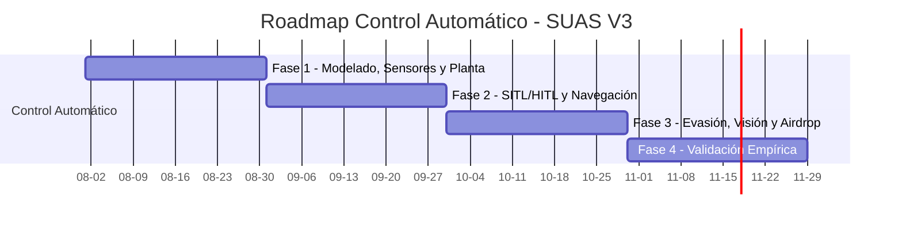

# Road-map AUVSI SUAS: Control Automático (Navegación, Autonomía y Evasión)

## Notas Arquitectónicas Críticas

1. **Hardware a Bordo (MCU):** La arquitectura emplea un microcontrolador (MCU, ej. STM32) con firmware estructurado estrictamente en C. Esto reduce latencia de sistema operativo, consumo energético y costos unitarios. Todo el lazo de control corre en bare-metal o RTOS sobre la MCU.
2. **Procesamiento Edge:** La visión artificial se ejecuta nativamente en el hardware acelerador (NPU) de la serie STM32N6. No se delega procesamiento de percepción a tierra.
3. **Sensores de baja latencia:** La IMU opera exclusivamente por bus SPI para minimizar latencia en el lazo de control. El magnetómetro opera por I2C como sensor de corrección de heading.

## Resumen de Requerimientos Críticos

* **Tolerancia máxima de error en waypoints:** 25 pies.
* **Failsafes obligatorios (Pérdida de enlace):** RTH a los 30 s, terminación de vuelo a los 3 min.
* **Rechazo de perturbaciones:** Viento hasta 24.2 mph sin oscilaciones subamortiguadas.
* **Airdrop:** Impacto preciso calculado con altitud, groundspeed y velocidad vectorial del viento.

## Diagrama de Fases

---

## Fase 1: Modelado Dinámico, Sensores y Selección de Planta

### 1.1 Selección de Stack de Vuelo

- Definir la arquitectura subyacente para el hardware embebido (MCU).

### 1.2 Especificación de Sensores y Periféricos

- **IMU (Acelerómetro + Giroscopio):** ICM-20602 o ICM-20948. **Restricción de bus:** Uso exclusivo de SPI para minimizar la latencia en el lazo de control.
- **Magnetómetro:** HMC5883L o QMC5883L operando mediante bus I2C.
- **Mapeo Geográfico:** Evaluar hardware LiDAR para estimación de altitud de precisión (distancia al suelo).
- **Interfaz de Visión:** Cámara conectada vía interfaz serial MIPI CSI directa al MCU.

### 1.3 Variables de Estado para el Lazo de Control

El MCU procesa en tiempo real las siguientes variables para los controladores de actitud y posición:

- **Actitud:** Ángulos de Euler (Roll, Pitch, Yaw) o Cuaterniones ($q_0, q_1, q_2, q_3$).
- **Tasas Angulares:** $p, q, r$ (grad/s o rad/s).
- **Aceleración Lineal:** $a_x, a_y, a_z$ ($m/s^2$).
- **Posición Espacial:** Latitud, longitud y altitud (relativa y absoluta).

### 1.4 Identificación de Sistemas

- Modelar matemáticamente la dinámica de vuelo del fuselaje en entornos como Matlab/Simulink.
- Calcular las derivadas de estabilidad longitudinal y lateral para evaluar el margen estático y la respuesta dinámica.

---

## Fase 2: Sintonización y Pruebas SITL/HITL (Software/Hardware In The Loop)

### 2.1 Lazos PID en Simulación

- Sintonizar los controladores de actitud y posición en entornos simulados (ej. Gazebo) inyectando ruido en los sensores virtuales.

### 2.2 Navegación Estricta

- Validar los algoritmos de seguimiento de trayectoria (como *L1 Navigation Controller*) para asegurar matemáticamente que la desviación de ruta y el error de radio en el waypoint no excedan los 25 pies reglamentarios.

### 2.3 Diagnóstico del Sistema en Tiempo Real

Monitoreo continuo de variables de diagnóstico para detección de anomalías durante las pruebas:

- Voltaje de batería.
- Consumo de corriente segregado (motores, cámara, MCU, transceptor RF).
- Modo de vuelo actual.
- RSSI del enlace (para coordinación con el área de telecomunicaciones).

---

## Fase 3: Evasión de Obstáculos, Visión Artificial y Balística de Carga (Airdrop)

### 3.1 Lógica de Evasión Reactiva

- Diseñar controladores basados estrictamente en disparadores de umbral a nivel de hardware (*hardware-level threshold triggers*), prescindiendo de algoritmos de inteligencia artificial. El sistema calcula una matriz de costos en tiempo real sobre estas señales físicas directas, desvía la trayectoria base para evadir obstáculos y retorna al plan original.

### 3.2 Visión Artificial para Detección

- **Procesamiento Edge:** Implementación de algoritmos de detección visual (Embedded YOLO) ejecutados nativamente en el hardware acelerador (NPU) de la serie STM32N6. No se delegará este procesamiento a tierra.
- **Correlación de Datos:** Sincronización estricta mediante el RTC (Real-Time Clock) del STM32. Cada fotografía capturada debe estamparse temporalmente de forma sincrónica con la coordenada espacial exacta (Foto + Posición).

### 3.3 Control de Liberación Predictivo (Airdrop)

- Desarrollar el modelo cinemático para el *Airdrop*.
- El algoritmo debe accionar el relé de liberación calculando el punto de impacto exacto, tomando como variables de estado la altitud, la velocidad respecto al suelo (groundspeed) y la estimación de velocidad vectorial del viento.

---

## Fase 4: Validación Empírica en Vuelo

### 4.1 Ajuste Dinámico en Hardware Real

- Ejecutar identificación del sistema en vuelo.
- Aplicar autotune y ajuste manual fino de las ganancias de control para amortiguar cualquier oscilación estructural.

### 4.2 Rechazo de Perturbaciones

- Medir el rendimiento de seguimiento frente a ráfagas de viento límite estipuladas por la competencia (hasta 24.2 mph).
- Oscilaciones subamortiguadas inhabilitarán las capacidades de la cámara a bordo.

---

## FAQ

**[PREGUNTA]: ¿Qué son los waypoints?**
[RESPUESTA]: Son coordenadas tridimensionales predefinidas (latitud, longitud y altitud) que establecen la ruta de vuelo autónomo del dron.

**[PREGUNTA]: ¿Qué son los failsafes y cuándo se activan?**
[RESPUESTA]: Son protocolos de seguridad automatizados. Se activan ante fallas críticas, como la pérdida prolongada del enlace de comunicaciones, baja batería o fallas en el GPS, ejecutando maniobras preprogramadas para evitar accidentes.

**[PREGUNTA]: ¿Qué significa RTH?**
[RESPUESTA]: RTH significa "Return to Home" (Retorno al punto de inicio). Es una maniobra autónoma donde el dron asciende a una altitud segura y regresa a las coordenadas exactas de despegue.

**[PREGUNTA]: ¿A qué se refiere la terminación de vuelo?**
[RESPUESTA]: Es el cese total e irreversible de las capacidades de vuelo del dron. Implica el corte de energía a los motores y la deflexión máxima de las superficies de control para forzar un descenso inmediato y controlado.

**[PREGUNTA]: ¿Qué son las simulaciones SITL y HITL?**
[RESPUESTA]: SITL (Software In The Loop) ejecuta tanto el controlador de vuelo como la simulación en un ordenador. HITL (Hardware In The Loop) conecta el hardware real del controlador al ordenador que simula el entorno físico.

**[PREGUNTA]: ¿Qué es Gazebo?**
[RESPUESTA]: Es un simulador físico 3D de alta fidelidad. Permite probar el comportamiento dinámico del dron y sus sensores en entornos virtuales complejos antes de realizar vuelos reales.

**[PREGUNTA]: ¿Qué es el L1 Navigation Controller?**
[RESPUESTA]: Es un algoritmo de control no lineal utilizado para la guía de trayectorias. Calcula la aceleración lateral necesaria para seguir una ruta basándose en un punto de referencia adelantado sobre la trayectoria deseada.

**[PREGUNTA]: ¿Cómo funcionan los controles reactivos y la matriz de costos?**
[RESPUESTA]: Un control reactivo ajusta la trayectoria en tiempo real ante obstáculos imprevistos. Utiliza una matriz de costos, que es una cuadrícula espacial donde cada celda tiene un valor de penalización por proximidad a obstáculos; el algoritmo busca la ruta con el menor costo acumulado para evadirlos.

**[PREGUNTA]: ¿Qué es el airdrop?**
[RESPUESTA]: Es la maniobra de liberación aérea de una carga útil desde el dron en vuelo continuo, la cual requiere cálculos balísticos precisos para impactar en un objetivo determinado en tierra.
