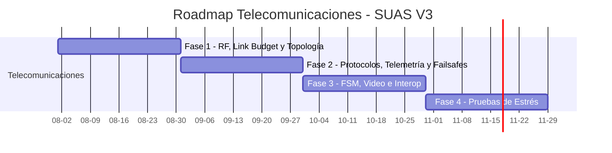

# Road-map AUVSI SUAS: Telecomunicaciones (Enlace C2, Telemetría e Interfaz)

## Notas Arquitectónicas Críticas

1. **MAVLink vs. LoRa:** MAVLink opera en la capa de aplicación/red para empaquetado de telemetría, mientras que LoRa es una modulación de capa física. Un enlace puro LoRa es inviable por su restricción estricta de ancho de banda. La arquitectura exige un stack industrial (MAVLink sobre transceptores IP o de 900 MHz) para soportar el flujo obligatorio de datos hacia el servidor Interop y la transmisión de video.
2. **Hardware a Bordo (MCU vs. SBC):** La variante principal emplea un microcontrolador (MCU, ej. STM32) con firmware estructurado estrictamente en C. Esto reduce latencia de sistema operativo, consumo energético y costos unitarios. El uso de una Single Board Computer (SBC) a bordo queda relegado a una notación secundaria o redundante; el procesamiento pesado de red se traslada a la estación terrena.
3. **Restricción de Transporte:** El protocolo TCP está prohibido sobre el enlace aéreo debido a las confirmaciones de entrega y el tamaño de los encabezados. La comunicación se basará en cargas útiles directas, gestionando la secuenciación mediante la capa de aplicación embebida en el firmware.

## Resumen de Requerimientos Críticos

* **Tolerancia máxima de error en waypoints:** 25 pies.
* **Failsafes obligatorios (Pérdida de enlace):** RTH a los 30 s, terminación de vuelo a los 3 min.
* **Telemetría constante:** Transmisión al servidor Interop.
* **Alcance del enlace:** Hasta 30 km en línea de vista (LoRa), hasta 12 millas de recorrido de misión.

## Diagrama de Fases

---

## Fase 1: Arquitectura de Radiofrecuencia, Link Budget y Topología del Enlace

### 1.1 Análisis de Espectro y Selección de Bandas

- Seleccionar bandas separadas para Comando y Control (C2) y para transmisión de datos/mapeo geográfico.
- **Bandas ISM libres:** Operación en 915 MHz (América) / 868 MHz (Europa), eliminando la dependencia de infraestructura de operadores celulares.

### 1.2 Topología de Telecomunicaciones (Dron ↔ Estación Base)

- **Alcance y Frecuencia:** Enlaces LoRa para un rango operativo de hasta 30 km en línea de vista.
- **Arquitectura de Capas OSI:**
  - **Capa 1 (Física):** LoRa determina la modulación de espectro ensanchado (CSS), la frecuencia y el ancho de banda físico.
  - **Capas 2 y 3 (Enlace y Red):** LoRaWAN define el protocolo MAC y el enrutamiento.
- **Restricción de Transporte:** TCP prohibido sobre el enlace aéreo. Comunicación basada en cargas útiles directas con secuenciación gestionada en la capa de aplicación del firmware.

### 1.3 Cálculo de Link Budget

- Dimensionar la potencia de transmisión y ganancia de antenas para garantizar un enlace robusto en un radio de acción compatible con el recorrido total de la misión (hasta 12 millas).

### 1.4 Hardware en Tierra

- Diseñar un sistema de antenas con seguimiento direccional (*antenna tracker*) automatizado para maximizar la relación señal a ruido (SNR) durante todo el vuelo.

---

## Fase 2: Protocolos de Comunicación, Telemetría y Failsafes

### 2.1 Implementación MAVLink

- Configurar la capa de mensajería estandarizada directamente en la MCU (STM32) manejando los buffers de transmisión en firmware C, enlazando con la Estación Terrena de Control (GCS).

### 2.2 Variables de Estado y Empaquetado de Telemetría

El MCU (STM32) ejecutará procesamiento mínimo para transmisión. Las variables de estado a calcular y empaquetar son:

- **Actitud:** Ángulos de Euler (Roll, Pitch, Yaw) o Cuaterniones ($q_0, q_1, q_2, q_3$).
- **Tasas Angulares:** $p, q, r$ (grad/s o rad/s).
- **Aceleración Lineal:** $a_x, a_y, a_z$ ($m/s^2$).
- **Posición Espacial:** Latitud, longitud y altitud (relativa y absoluta).
- **Diagnóstico del Sistema:** Voltaje de batería, consumo de corriente segregado (motores, cámara, MCU, transceptor RF), modo de vuelo actual y RSSI del enlace.

### 2.3 Lógica de Pérdida de Enlace

- Programar la respuesta autónoma estricta en el controlador. A los 30 segundos sin recepción de latidos (*heartbeats*), forzar el *Return To Home* (RTH) o *Return to Land* (RTL). A los 3 minutos, ejecutar la terminación de vuelo mecánica y lógica (corte de acelerador, deflexión máxima de superficies de control).

---

## Fase 3: Máquina de Estados Finita (FSM), Video e Interop

### 3.1 Asignación de Ancho de Banda (Video bajo demanda)

- Implementar una FSM en la MCU. El estado nominal reserva el ancho de banda para telemetría estricta. Al recibir un comando atómico desde la GCS (ej. petición HTTP GET), se levanta un bit lógico que activa la codificación de mapeo geográfico y abre el flujo de transmisión exclusivamente para la etapa de vuelo manual.

### 3.2 Visión Artificial y Sincronización de Datos

- **Procesamiento Edge:** Implementación de algoritmos de detección visual (Embedded YOLO) ejecutados nativamente en el hardware acelerador (NPU) de la serie STM32N6. No se delegará este procesamiento a tierra.
- **Correlación de Datos:** Sincronización estricta mediante el RTC (Real-Time Clock) del STM32. Cada fotografía capturada debe estamparse temporalmente de forma sincrónica con la coordenada espacial exacta (Foto + Posición).

### 3.3 Desarrollo de API Cliente (Interop)

- Programar servicios en la SBC de la estación terrena (GCS) que extraigan los datos de telemetría provenientes de la MCU y los transmitan vía HTTP/JSON al servidor Interop de la competencia.

---

## Fase 4: Pruebas de Estrés y Espectro

### 4.1 Análisis de Interferencia

- Medir latencia de conmutación de la FSM de video y pérdida de paquetes bajo condiciones de saturación de canal simulada.

### 4.2 Pruebas de Actitud de Antenas

- Verificar la polarización cruzada y las pérdidas por desvanecimiento durante alabeos (roll) y cabeceos (pitch) extremos del fuselaje en vuelo.

---

## FAQ

**[PREGUNTA]: ¿Qué es el enlace C2?**
[RESPUESTA]: C2 significa Comando y Control (Command and Control). Es el enlace de radiofrecuencia bidireccional de alta prioridad y baja latencia utilizado para enviar instrucciones al dron y recibir telemetría crítica.

**[PREGUNTA]: ¿Qué es el servidor Interop?**
[RESPUESTA]: Es el servidor de interoperabilidad de la competencia AUVSI SUAS. Se encarga de recibir, evaluar y registrar en tiempo real la telemetría del dron y los datos de las misiones procesados por los equipos.

**[PREGUNTA]: ¿Qué son los failsafes y cuándo se activan?**
[RESPUESTA]: Son protocolos de seguridad automatizados. Se activan ante fallas críticas, como la pérdida prolongada del enlace de comunicaciones, baja batería o fallas en el GPS, ejecutando maniobras preprogramadas para evitar accidentes.

**[PREGUNTA]: ¿Qué significa RTH?**
[RESPUESTA]: RTH significa "Return to Home" (Retorno al punto de inicio). Es una maniobra autónoma donde el dron asciende a una altitud segura y regresa a las coordenadas exactas de despegue.

**[PREGUNTA]: ¿A qué se refiere la terminación de vuelo?**
[RESPUESTA]: Es el cese total e irreversible de las capacidades de vuelo del dron. Implica el corte de energía a los motores y la deflexión máxima de las superficies de control para forzar un descenso inmediato y controlado.

**[PREGUNTA]: ¿Qué es la SBC?**
[RESPUESTA]: SBC significa "Single Board Computer". En esta variante de arquitectura, su uso a bordo del dron queda relegado, centralizando el procesamiento lógico en una MCU para optimizar recursos. La SBC se emplea principalmente en la estación terrena para procesamiento de red e interfaz.

**[PREGUNTA]: ¿Qué es la GCS?**
[RESPUESTA]: GCS significa "Ground Control Station" (Estación Terrena de Control). Es el centro de mando en tierra desde el cual los operadores monitorean la telemetría, configuran misiones y controlan la carga útil.

**[PREGUNTA]: ¿Qué es la polarización cruzada?**
[RESPUESTA]: Es una atenuación severa de la señal que ocurre cuando la alineación de la onda electromagnética de la antena transmisora no coincide con la de la receptora, causando degradación o pérdida de enlace.

**[PREGUNTA]: ¿Qué son las pérdidas por alabeos y cabeceos?**
[RESPUESTA]: Son caídas en la potencia de la señal recibida cuando las maniobras de inclinación lateral (roll) o longitudinal (pitch) del dron cambian el patrón de radiación de las antenas respecto a la estación terrena.
